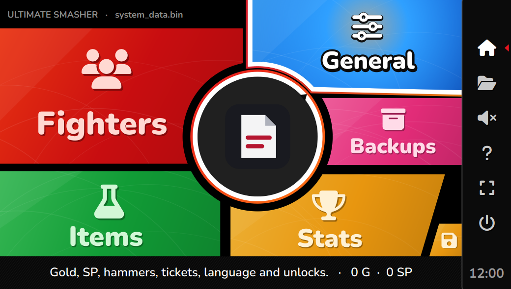

# Ultimate Smasher

**Edit Super Smash Bros. Ultimate saves on Linux.** A Python and PyQt5 desktop editor with change review, backups, and keyboard and controller navigation.

[Quick start](#quick-start) · [Editing tools](#editing-tools) · [Controls](#controls) · [Compatibility](#compatibility)



## Quick start

Install Python 3.10 or newer with venv support, then run:

```sh
git clone https://github.com/Edxen12/Ultimate-Smasher.git
cd Ultimate-Smasher
python3 -m venv .venv
. .venv/bin/activate
python -m pip install -r requirements.txt
python "Ultimate Smasher.py"
```

The editor looks for saves in known Ryujinx and Ryubing locations. To choose one, open **Files** or pass a path:

```sh
python "Ultimate Smasher.py" "/path/to/system_data.bin"
```

Use `--fullscreen` to start in fullscreen. Optional sound effects play through `pw-play` or `paplay`. Set `SMASHER_MUTE=1` to start muted.

## Editing tools

| Section | What you can edit |
| --- | --- |
| **General** | Gold, SP, hammers, tickets, game language, milestones, and Mii clothes |
| **Items** | Snacks, Spirit Board items, and battle items |
| **Characters** | Unlock or lock 71 base fighters individually or in bulk |
| **Stats** | Search and edit records across six categories |
| **Backups** | Snapshot disk saves, filter by source, and load a backup into the editor |

Open **Files → Review Changes** to see the original and edited values before writing them. **Export Copy** writes your edits to a new file. Loading a backup is undoable and writes to disk only when you choose **Save**.

## Controls

| Action | Keyboard |
| --- | --- |
| Navigate and select | Arrow keys and Enter |
| Open files or show the file menu | Ctrl+O or Alt+F |
| Save or export a copy | Ctrl+S or Ctrl+Shift+S |
| Review pending edits | Ctrl+I |
| Undo or redo | Ctrl+Z or Ctrl+Shift+Z |
| Change section | Q/E or Ctrl+Page Up/Page Down |
| Back, fullscreen, help | Esc, F11, F1 |

On Linux, controllers with readable evdev devices can navigate with the D-pad or left stick. Cross/A confirms, Circle/B goes back, L1/R1 change section, and Options/Start saves.

## Compatibility

- Supports the inherited `system_data.bin` layout of **5,982,968 bytes**. File size alone does not confirm compatibility. DLC fighter flags are outside the supported layout.
- Close the game before saving. The editor checks for changes on disk, creates a recovery copy, and updates the Ryujinx slots separately. If the save changes externally, the editor keeps your pending edits and offers to export them.
- The public checkout runs with its bundled artwork. You can add optional local images in `img/portraits`, `img/renders`, `img/stock`, and `img/series`, plus a hub image at `img/hub-art.png`. These paths are ignored by Git.

## Development

```sh
python -m unittest discover
```

The suite includes offscreen UI tests. Set `SMASH_TEST_SAVE=/path/to/system_data.bin` to run the save tests on temporary copies of an existing file.

## Credits and license

Based on the original [Ultimate Smasher by Ret-HZ](https://github.com/Ret-HZ/Ultimate-Smasher). The project source uses the [GNU GPL v2](LICENSE). This is an unofficial editor.

Bundled fonts have their own licenses for [Barlow Condensed](fonts/OFL.txt), [Nunito](fonts/OFL-Nunito.txt), and [Font Awesome Free](fonts/LICENSE-Font-Awesome.txt).
